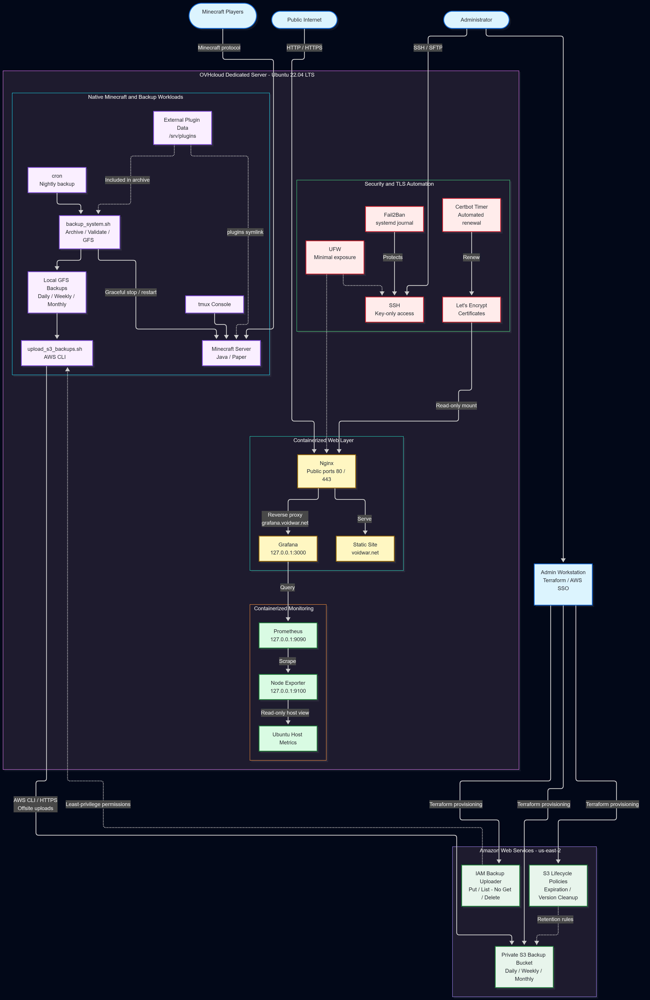

# VoidWar Infrastructure

My interest in Linux infrastructure began at 13, when I rented my first OVHcloud Kimsufi bare-metal server to host a multiplayer environment for friends. I learned through experimentation, broken configurations, and countless hours figuring out how remote systems worked. That fascination stayed with me and eventually led me to pursue a degree in Computer Science and earn the Red Hat Certified System Administrator (RHCSA) certification.

**VoidWar is the current culmination of that long-running interest:** a persistent, remotely administered Linux environment incorporating security hardening, infrastructure automation, containerized services, observability, and offsite cloud backups.

This repository documents the infrastructure I operate, the engineering decisions behind it, and the procedures used to maintain and recover it. It contains sanitized configuration, automation scripts, Terraform code, and operational documentation derived from a live deployment—not a disposable tutorial environment.

## Infrastructure at a Glance

| Area | Implementation |
|---|---|
| **Compute** | OVHcloud dedicated bare-metal server running Ubuntu Server 22.04 LTS |
| **Application workload** | Java/Paper Minecraft server managed natively with Bash and `tmux` |
| **Web and TLS** | Dockerized Nginx, HTTPS via Let's Encrypt, automated certificate renewal |
| **Observability** | Prometheus, Node Exporter, and Grafana |
| **Security** | SSH key authentication, UFW, Fail2Ban, restricted service exposure |
| **Local recovery** | Automated compressed backups with Grandfather-Father-Son retention |
| **Offsite recovery** | Private Amazon S3 storage, IAM least privilege, lifecycle policies |
| **Infrastructure as code** | Terraform provisioning for AWS backup resources |

## Architecture



The Minecraft workload and supporting services run on the OVHcloud host. **AWS is used for offsite backup storage, not application hosting.** Terraform provisions the S3 and IAM resources from an administrative workstation.

For the complete design, service boundaries, data flows, and tradeoffs, see [`docs/architecture.md`](docs/architecture.md). The diagram's editable source is [`diagrams/architecture.mmd`](diagrams/architecture.mmd).

## Deployment and Operations

### Bare-Metal Linux Host

The environment runs on a dedicated server with an Intel Xeon E3-1230 v6, 16 GB ECC RAM, and two 450 GB NVMe drives configured as software RAID 0. The hardware provides a persistent remote environment at approximately $21 per month.

RAID 0 provides no disk redundancy, making backup validation and offsite retention especially important to the recovery strategy.

The Minecraft application runs directly on Ubuntu, with `tmux` preserving console access across SSH sessions. Supporting web and monitoring services run in Docker Compose. Runtime data and sensitive configuration remain outside the public repository.

### Public Web Services and Observability

Nginx terminates HTTPS for `voidwar.net` and reverse-proxies `grafana.voidwar.net` to Grafana. Let's Encrypt certificates are renewed through `certbot.timer`, with a deployment hook to validate and reload Nginx after renewal.

The monitoring pipeline is **Node Exporter → Prometheus → Grafana**. Grafana is accessed through Nginx; Prometheus, Node Exporter, and Grafana's backend listener are bound to loopback rather than exposed directly to the internet.

See [`docs/nginx-tls-deployment.md`](docs/nginx-tls-deployment.md) and [`docs/monitoring-stack.md`](docs/monitoring-stack.md).

### Security and Access Control

The host uses key-only SSH authentication, disabled direct root login, UFW's default-deny inbound policy, and Fail2Ban protection for SSH. Administrative and collaborator access is separated through Linux users, groups, and filesystem permissions.

Docker services use restricted mounts and other hardening controls where appropriate. Credentials, private keys, certificates, backups, and runtime data are excluded from version control.

See [`docs/security-hardening.md`](docs/security-hardening.md).

## Backup and Recovery

Nightly Bash automation coordinates player warnings, graceful Minecraft shutdown, compressed archive creation, service restart, logging, and local backup rotation. The local retention policy keeps **7 daily, 4 weekly, and 6 monthly** backups.

Retained backups are also synchronized to a **private Amazon S3 bucket in `us-east-2`**, providing an offsite copy independent of the dedicated server. The AWS infrastructure is managed with Terraform and includes:

- A versioned, server-side-encrypted S3 bucket with lifecycle-based retention and version cleanup.
- A dedicated IAM uploader identity limited to the S3 permissions needed for uploads and object listing, without object download or deletion permissions.
- AWS CLI-based synchronization of retained local backups, designed to tolerate interrupted uploads and retry on a later run.

Backup retrieval and archive integrity have been tested, including inspection of Minecraft world and external plugin data. **A full bare-metal disaster-recovery restore has not yet been performed.**

See [`docs/backup-workflow.md`](docs/backup-workflow.md) and [`docs/restore-procedure.md`](docs/restore-procedure.md).

## Infrastructure as Code

Terraform configuration under [`terraform/aws/`](terraform/aws/) manages the AWS resources used for offsite backups, with reusable modules and a development environment under `terraform/aws/environments/dev`.

Provisioning is performed from an administrative workstation using AWS SSO credentials. The dedicated server uses a narrowly scoped uploader identity rather than broad administrative credentials.

## Validation and Maintenance

Operational checks documented for this environment include:

- Docker Compose configuration and Nginx syntax validation.
- HTTPS endpoint checks, TLS inspection, and certificate-renewal testing.
- Grafana and Prometheus health checks, target verification, and host-metric retrieval.
- SSH, firewall, listening-address, and Fail2Ban verification.
- Backup execution, restart behavior, S3 synchronization, and downloaded-archive inspection.

Maintenance procedures and troubleshooting steps are documented in [`docs/maintenance-runbook.md`](docs/maintenance-runbook.md).

## Repository Structure

```text
.
├── config/                         # Sanitized security configuration
│   ├── fail2ban/
│   ├── ssh/
│   └── ufw/
├── diagrams/
│   ├── architecture.mmd            # Editable Mermaid source
│   └── architecture.png            # Architecture diagram
├── docker/
│   ├── monitoring/                 # Prometheus, Grafana, Node Exporter
│   └── nginx/                      # HTTPS reverse proxy and static site
├── docs/                           # Architecture and operational documentation
│   ├── architecture.md
│   ├── backup-workflow.md
│   ├── maintenance-runbook.md
│   ├── monitoring-stack.md
│   ├── nginx-tls-deployment.md
│   ├── restore-procedure.md
│   └── security-hardening.md
├── scripts/
│   ├── backup_system.sh            # Local backup and retention automation
│   ├── upload_s3_backups.sh        # Offsite S3 backup synchronization
│   └── verify_infrastructure.sh    # Infrastructure validation
├── terraform/
│   └── aws/
│       ├── environments/
│       │   └── dev/                # Terraform root configuration
│       └── modules/
│           ├── iam-backup-uploader/ # Least-privilege IAM resources
│           └── s3-backups/         # S3 bucket and lifecycle configuration
├── .gitignore
└── README.md
```

## Technical Documentation

| Document | Focus |
|---|---|
| [Architecture](docs/architecture.md) | Components, trust boundaries, data flows, and design decisions |
| [Backup Workflow](docs/backup-workflow.md) | Backup execution, retention, and offsite synchronization |
| [Restore Procedure](docs/restore-procedure.md) | Recovery steps and verification |
| [Security Hardening](docs/security-hardening.md) | SSH, firewall, Fail2Ban, and access controls |
| [Monitoring Stack](docs/monitoring-stack.md) | Prometheus, Node Exporter, and Grafana |
| [Nginx and TLS Deployment](docs/nginx-tls-deployment.md) | HTTPS, reverse proxying, and certificate renewal |
| [Maintenance Runbook](docs/maintenance-runbook.md) | Routine operations and troubleshooting |


## Future Improvements

VoidWar is an ongoing infrastructure engineering project. Future development will focus on improving operational reliability, automation, observability, and disaster recovery while preserving the existing bare-metal architecture.

### Reliability and Disaster Recovery

- Perform a complete disaster-recovery exercise, restoring Minecraft world data, external plugin data, and application configuration from S3 backups into an isolated environment.
- Validate recovery procedures against realistic failure scenarios, including complete loss of the primary server.
- Establish documented recovery time and recovery point objectives (RTO/RPO).
- Introduce automated backup health checks and notifications for failed or missed uploads.

### Monitoring and Observability

- Implement Prometheus alerting rules and Alertmanager notifications for infrastructure failures and resource exhaustion.
- Deploy external uptime monitoring for public services.
- Develop custom Grafana dashboards tailored to the Minecraft workload and supporting infrastructure.
- Expand application-level monitoring beyond host metrics to include Minecraft process health and service availability.

### Security and Infrastructure Automation

- Develop a controlled, automated security-update workflow with appropriate validation and rollback procedures.
- Introduce CI/CD checks for repository configuration, shell scripts, and Terraform code.
- Expand infrastructure validation to detect configuration drift and common operational failures.
- Continue refining least-privilege access, credential management, and operational security practices.

### Infrastructure as Code and Cloud Expansion

- Extend Terraform coverage where it provides meaningful operational benefits.
- Improve Terraform module testing, documentation, and automated validation.
- Evaluate additional AWS services where they solve practical infrastructure problems rather than introducing unnecessary complexity.
- Explore Microsoft Azure as a potential future platform for additional infrastructure and automation experience.

The long-term objective is to evolve VoidWar into an increasingly reliable, observable, secure, and reproducible infrastructure environment, with each improvement implemented and validated against real operational requirements.
